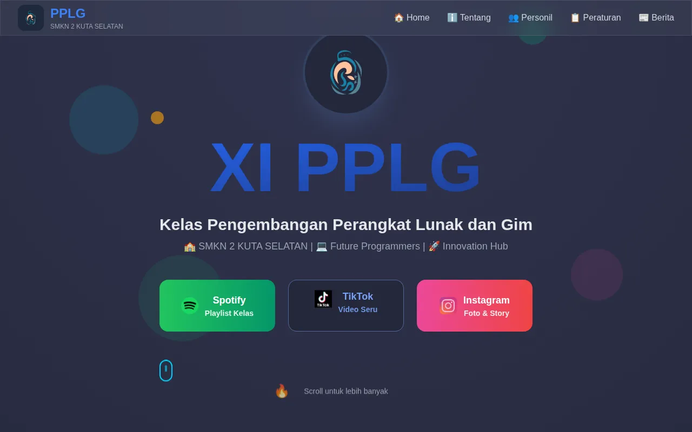
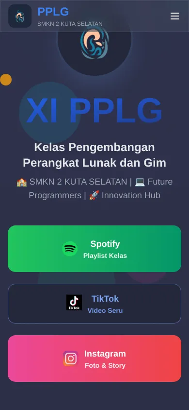

# XI PPLG, SMKN 2 Kuta Selatan

Website kelas kita waktu masih XI PPLG. Isinya jadwal pelajaran, data kas, foto bareng, dan berita kelas, semuanya di satu tempat biar nggak perlu nanya di grup terus.

**Buka:** [zynxx24.github.io/XI-PPLG/general](https://zynxx24.github.io/XI-PPLG/general/)

<p>
  
  
</p>

## Ada apa aja

- **Beranda**: tentang kelas, personil (wali kelas, guru jurusan, teman sekelas), peraturan kelas, dan berita atau lomba terbaru yang diambil dari Google Sheets.
- **Jadwal pelajaran** dan jadwal piket.
- **Data kas**: biar semua bisa lihat uang kas dipakai buat apa.
- **Foto bareng**: galeri momen kelas.
- Link ke playlist Spotify, TikTok, dan Instagram kelas.

## Dibuat pakai

HTML, Tailwind CSS (lewat CDN), dan JavaScript biasa. Nggak ada build step. Data jadwal, piket, dan foto ada di file JSON di `general/class/JSON/`, jadi gampang diubah tanpa nyentuh HTML.

## Jalankan di laptop

```bash
git clone https://github.com/zynxx24/XI-PPLG.git
cd XI-PPLG
python3 -m http.server 8000
# buka http://localhost:8000/general/
```

Bisa juga pakai extension Live Server di VS Code. Buka langsung lewat double click juga jalan, tapi data dari file JSON kadang nggak kebaca karena browser memblokir `fetch` ke `file://`.

Penjelasan struktur folder dan cara ubah datanya ada di [dokumentasi.md](dokumentasi.md).

## Mau ikut ngubah?

Fork repo ini, bikin branch, terus kirim pull request. Usahakan ikut gaya kode yang sudah ada, dan kalau nambah data (jadwal, foto, piket), ubah file JSON-nya saja.

Dibuat oleh Guswira. Lisensi [MIT](LICENSE).
